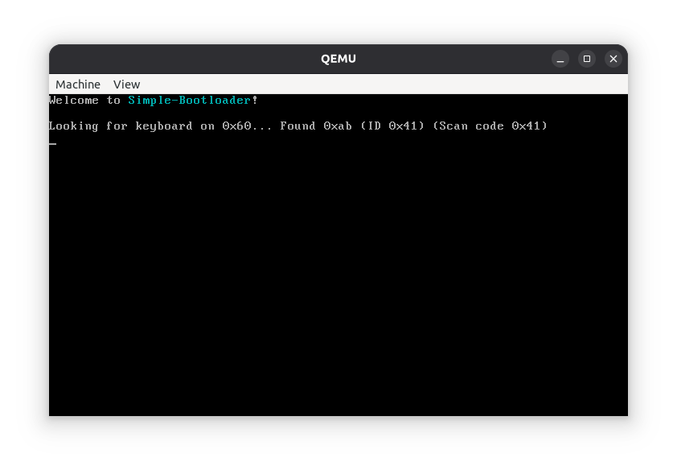

# simple-bootloader

As the name suggests, this is a very basic bootloader.

## How does it work
`src/boot.asm` sets up a minimum GDT and Stack in order for the main function in `src/main.c` to run.
It disables BIOS interruptions, enters protected mode and runs the code, just like that.
Under `src/lib/` there are some utilities for printing on VGA text mode, and the `inb` and `outb` functions.

## Building
- Simply run `make` on the root folder to build and run everything.
- Requires [NASM](https://www.nasm.us/) and [QEMU](https://www.qemu.org/).
